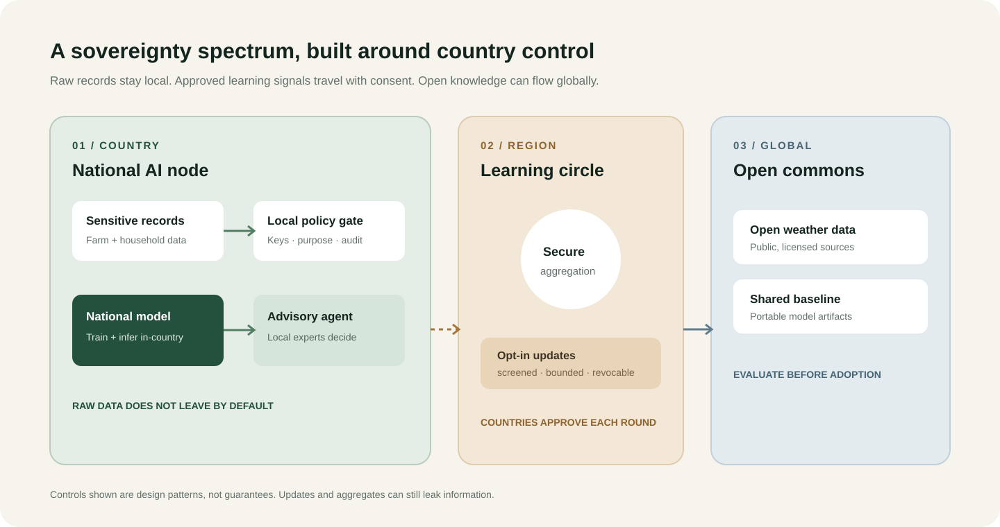

# Terra Sovereign AI

**Build useful AI at home. Collaborate across borders on a country's own terms.**

Terra is an open concept and interactive prototype for a drought and crop-risk intelligence network. It shows how countries can keep sensitive records and national decisions local, opt into regional learning, and use global open knowledge where it is suitable.

> Prototype only: synthetic data and illustrative values. No live model or data source is connected. This is not legal certification, and federated updates or aggregates are not automatically safe to share.

## Prototype screenshots

### Country nodes and shared outcomes

### Regional drought scenario

## Architecture

## The use case

Drought crosses borders, while farm locations, yields, household records, land tenure, and response plans can be sensitive. A national node trains and serves its advisory model locally. A country may approve a regional learning round where screened model updates travel and improved weights return. Open weather and agronomy resources can seed a global baseline; each country evaluates and adopts it locally.

The field agent may summarize risk, explain uncertainty, and draft guidance. It cannot contact farmers, reach outside its approved local role, or change public advice without an accountable human. Production controls must be enforced by tool gateways and identity systems, not prompts alone.

## Sovereignty across the AI stack

| Layer | Country control |
|---|---|
| Data | Classify, locate, access, retain, and delete under national policy. |
| Compute | Operate at home or use trusted regional capacity under national keys and policy. |
| Models | Evaluate, fine-tune, host, replace, and retire models and weights. |
| Agents | Set identities, tool allowlists, budgets, audit trails, approvals, and hard stops. |
| Supply chain | Use open interfaces, reproducible builds, fallbacks, and provider portability. |
| Collaboration | Opt in, pause, inspect benefit, revoke, and exit each shared round. |

Sovereignty does not mean a country must manufacture every chip or train every foundation model alone. It means retaining the authority and capability to decide what runs, what data moves, what actions are allowed, and how to change course.

## Run the demo

Open `index.html`, or run `python3 -m http.server 8000` and visit `http://localhost:8000`. Change the national node and collaboration level, then run the simulated drought scenario.

## From demo to pilot

Start with a narrow purpose and synthetic or approved historical data. Convene public agencies, farmer organizations, local researchers, and data stewards. Agree on residency, export review, threat models, reciprocal benefit, human approvals, incident response, and exit procedures before any multi-country training. Evaluate forecast quality, fairness, leakage risk, cost, and local operating capacity.

## Repository

`index.html` is the page, `styles.css` the responsive design, `app.js` the simulator, and `architecture.svg` the shareable system diagram. See [CONTRIBUTING.md](CONTRIBUTING.md).

## License

MIT for the prototype code. No real data or trained model weights are included.
