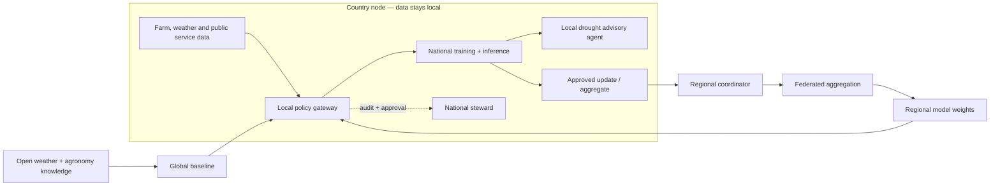

# Terra Sovereign AI

**A practical blueprint for every country to build useful AI at home, collaborate on shared challenges, and contribute safely to global models.**

Terra Sovereign AI is an open, interactive prototype for a continent-spanning drought and crop-risk intelligence network. It demonstrates a simple principle: sovereignty is not an on/off switch. A country can keep sensitive records and decisions inside its borders, share carefully governed learning signals with peers, and still use lower-risk open models and knowledge across regions.

> **Prototype notice:** This is a concept demo with synthetic data. It is not a production model, legal compliance certification, or a claim that federated learning, aggregation, or de-identification makes data automatically safe to share.


## The use case: drought resilience without exporting farm records

Smallholder farms face drought patterns that cross national borders. Governments and local institutions need early warning, crop-risk estimates, and actionable guidance. Yet farm locations, household records, yields, land tenure, and public response plans may be sensitive or subject to local residency rules.

Terra lets each country train and run its own national model where its data lives. Countries may then opt in to a regional learning round: only approved model updates or bounded statistics leave the country, after local review and privacy controls. A regional model can return improved weights to national nodes. Public weather and open agronomy knowledge can be used globally, while each country decides which models and results it trusts.

### What the prototype shows

- **National node:** synthetic farm data stays in the country; local inference and policy control.
- **Regional learning circle:** opt-in collaboration across neighboring countries using screened updates, not raw records.
- **Global commons:** open, low-sensitivity weather and agronomy knowledge can improve shared baseline models.
- **Decision boundary:** policy gates make residency, purpose, access, retention, and export approval visible.
- **Working interaction:** change the collaboration level and run a drought scenario to see what moves, what stays, and what benefit returns.

### How far can sovereignty go?

Sovereignty can cover more than data location. A country can grow control across the full AI stack:

1. **Data:** national classification, residency, consent, access, retention, and deletion rules.
2. **Compute:** locally operated infrastructure, or trusted regional capacity under a country's own key and policy control.
3. **Models:** ability to inspect, evaluate, fine-tune, host, replace, and retire models; keep weights and logs governed at home.
4. **Agents:** local identity, tool allowlists, action budgets, approval gates, audit trails, and a hard stop. High-impact actions such as changing a public advisory require an accountable person.
5. **Supply chain:** open interfaces, reproducible builds, documented dependencies, fallback plans, and the ability to switch providers.
6. **Shared capability:** negotiate collaboration terms collectively while each country retains a clear opt-in, pause, and exit path.

No country needs to build every chip or foundation model alone to have meaningful sovereignty. Practical sovereignty means retaining the capacity and authority to decide where data goes, which systems run, what actions they may take, and how to change course.

### Agent boundary in the drought example

The field agent can summarize a risk signal, explain uncertainty, suggest questions for an agronomist, and prepare a draft advisory. It does not contact farmers, access records outside its approved local role, or change public guidance on its own. A production design should enforce these limits in the tool gateway and identity layer, not rely on prompt text.

## Run it

This is a static site with no dependencies or build step. Open `index.html` directly, or serve the repository locally:

```bash
python3 -m http.server 8000
```

Then visit `http://localhost:8000`.

## Sovereignty is a spectrum

| Layer | Data and compute | Collaboration | Example controls |
|---|---|---|---|
| Country | Identifiable and sensitive data remains in-country; national inference and agent tools run under local control | No export by default | Residency policy, local keys, purpose limits, audit log, human approval |
| Regional | Raw records remain local; approved updates or aggregate indicators can cross borders | Federated rounds among consenting countries | Minimum cohort, clipping/noise where appropriate, update screening, revocation, reciprocal benefit |
| Global | Open or low-sensitivity data and public model artifacts | Shared baselines and reusable tools | License and provenance checks, model evaluation, opt-in adoption |

These are governance patterns, not guarantees. Model updates can leak information; aggregates can expose small groups; open datasets may have licensing or re-identification risks. Each data class needs a threat model and a country-specific legal review.

## Architecture



The coordinator never needs access to raw country records in this design. In a production deployment, the coordinator, secure aggregation protocol, model registry, identity system, and every participating country would need independent review. Some settings may require confidential computing, differential privacy, or no sharing at all.

## Design principles

1. **Local by default:** sensitive data and high-impact decisions stay under national jurisdiction.
2. **Country control:** each country can join, pause, inspect, and leave a collaboration round.
3. **Share the minimum:** export only the least revealing artifact needed for a defined joint benefit.
4. **Reciprocity:** contributors can see what improved and receive usable model updates and services.
5. **Open foundations:** favor open standards, portable models, and replaceable infrastructure to avoid lock-in.
6. **People stay accountable:** agents may summarize and recommend; local experts authorize high-impact action.
7. **Measure harm as well as accuracy:** evaluate by region, language, farm size, gender where appropriate, and data coverage.

## From demo to pilot

1. Convene agriculture agencies, farmer organizations, local research institutions, data-protection authorities, and regional bodies.
2. Agree a narrow purpose, data inventory, residency map, threat model, benefit-sharing agreement, and exit procedure.
3. Start with a single-country baseline on synthetic or approved historical data; keep the model advisory.
4. Run a tabletop exercise and red-team the export boundary before a multi-country round.
5. Compare local-only and federated results for forecast quality, fairness, privacy leakage, costs, and operator capacity.
6. Publish evaluations and incident procedures; scale only when participating communities see clear benefit.

## Repository

- `index.html` — page structure
- `styles.css` — responsive visual system
- `app.js` — scenario simulator and policy interactions
- `assets/architecture.svg` — shareable system diagram
- `LICENSE` — MIT license

## Contributing

Ideas welcome: add a country policy profile, propose threat-model tests, improve accessibility, or adapt the example to health, education, or public services. Keep demos synthetic and document assumptions. See [CONTRIBUTING.md](CONTRIBUTING.md).

## License

MIT for the prototype code. Data, model weights, and third-party datasets are not included; their terms must be assessed separately.
